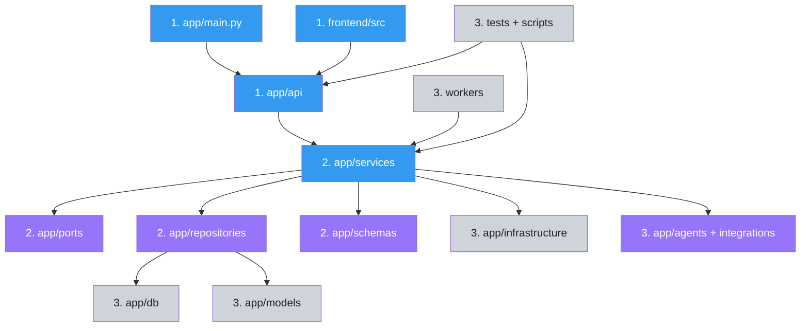

# 智能财富管家团队上手与脚手架

## 1. 这是什么项目

这是一个**模块化单体（Modular Monolith）**财富管理 Mock/MVP：前端使用 Vue 3 + Vite，后端使用 FastAPI + SQLAlchemy Async，PostgreSQL/pgvector 承担主业务库与向量检索，Redis Streams 承担异步任务与 Outbox 分发；知识库、客服 Agent、风控、交易、工单和后台运营共用一个后端进程及多个独立 Worker。

项目已经具备可运行的业务骨架，但目前更像“功能持续演进中的研发仓库”，还不是标准化的团队模板。新增的脚手架入口是：

```powershell
.\scripts\team_bootstrap.ps1
```

脚手架默认只启动本地 P0 环境，不会启动 MySQL、Milvus 或 AML 日批；这些是验证/扩展能力，按需单独启用。

## 2. 新成员 5 分钟启动

前置条件：Docker Desktop、Node.js/npm、PowerShell 7（Windows 推荐）。

```powershell
# 在仓库根目录执行
.\scripts\team_bootstrap.ps1

# 另开终端启动前端
Set-Location frontend
npm run dev -- --host 127.0.0.1
```

访问：

- 前端：`http://127.0.0.1:5173`
- 后端健康检查：`http://127.0.0.1:8010/api/v1/health`
- 后端 OpenAPI：`http://127.0.0.1:8010/docs`

脚手架行为：

1. 检查 Docker Compose、Node/npm 和项目目录；
2. 不覆盖已有 `.env`，首次使用时从 `.env.example` 复制；
3. 创建 `uploads/knowledge` 和 `uploads/workorders`；
4. 安装前端锁定依赖（`npm ci`）；
5. 构建并启动 `docker-compose.p0.yml`；
6. 等待 API 健康检查通过，并打印下一步命令。

常用参数：

```powershell
# 已经构建过镜像时跳过 build
.\scripts\team_bootstrap.ps1 -SkipBuild

# 不安装前端依赖，只启动后端基础设施
.\scripts\team_bootstrap.ps1 -SkipFrontend

# 启动后清空本地业务演示数据并重新 seed；只允许 development/local
.\scripts\team_bootstrap.ps1 -ResetData

# 额外启动 AML Scheduler
.\scripts\team_bootstrap.ps1 -StartAml

# 使用全量 docker-compose.yml（包含 Milvus 等扩展服务）
.\scripts\team_bootstrap.ps1 -FullStack
```

停止服务时使用：

```powershell
docker compose -f docker-compose.p0.yml stop
```

不要在日常开发中使用 `docker compose down -v`，否则会删除本地数据库/Redis 数据卷。

## 3. 目录地图



### 用户直接接触的部分

- `frontend/src/views`：客户、员工、顾问、管理员页面。
- `frontend/src/api`：前端 API 客户端；统一通过 `frontend/src/api/http.ts` 访问 `/api`。
- `frontend/src/stores/auth.ts`：登录态、当前用户和权限信息。

### 业务编排部分

- `app/api`：HTTP 路由、鉴权、参数校验和响应组装；不要在这里堆积复杂业务规则。
- `app/services`：业务用例、状态流转、风控、交易、知识库、通知、记忆和任务编排。
- `app/ports`：Repository、Agent、交易和向量库的抽象契约。
- `app/repositories`：PostgreSQL/MySQL 适配和 Unit of Work；跨数据库改动需要走文档门禁。
- `app/agents`、`app/integrations`：Agent 图编排以及 LangChain/Qwen 等集成边界。
- `app/schemas`：HTTP 输入输出 DTO；`app/models`：数据库持久化模型。

### 基础设施与异步部分

- `app/db`：数据库连接、schema 初始化和数据库健康检查。
- `app/infrastructure`：Redis、Qwen、pgvector/Milvus 等外部依赖。
- `workers`：Outbox、通知、知识库、数据目录、客服超时和 AML Scheduler。
- `docker-compose.p0.yml`：组员日常开发的最小可运行环境。
- `docker-compose.yml`：全量扩展环境，按需使用。
- `tests`：稳定的 HTTP/故障/并发测试；`scripts`：验收、迁移和专项诊断脚本。

## 4. 推荐阅读顺序

1. `README.md`、本文件和 `docs/DEVELOPMENT_WORKFLOW.md`；
2. `app/main.py`：启动生命周期、schema/seed 和应用状态；
3. `app/api/__init__.py` 及目标业务对应的 `app/api/*.py`；
4. 对应 `app/services/*.py`；
5. `app/ports`、`app/repositories`、`app/models`、`app/schemas`；
6. 目标业务对应的 `workers/*.py`、`app/infrastructure/*`；
7. 最后看 `frontend/src/views` 和 E2E 测试，核对真实交互契约。

## 5. 代码约定

- 文件/模块使用小写下划线；Vue 组件和视图使用 PascalCase；类使用 PascalCase；函数/变量使用 snake_case 或 camelCase，跟随所在语言既有风格。
- API → Service → Port/Repository 是默认调用方向。路由层负责 HTTP，不直接拼装数据库细节。
- Service 通过 Repository/UoW 访问业务数据；不要在新接口中绕过已有抽象直接创建连接或写 SQL。
- `models` 是持久化模型，`schemas` 是 API DTO，二者不要混用。
- 异步外部任务使用 Redis Stream/Outbox/Worker；不要在 HTTP 请求里同步执行长时间 embedding、批量通知或日批扫描。
- 应用异常集中在 `app/common/exceptions`；HTTP 错误码和响应格式参考 `docs/ERROR_CODES.md` 与 `app/common/response`。
- 新增 API 时同时补：schema、权限边界、HTTP 测试或契约测试、`docs/API.md`（若 API 文档由人工维护）。
- 所有业务改动都要更新对应的 `docs/PLAN.md`、`docs/TESTS.md` 或 `docs/ISSUES.md`；形成新决策时更新 `docs/DECISIONS.md`。

## 6. 危险区与修改前检查

- `app/main.py`：启动时会执行 schema 和多类 demo seed；修改生命周期要完整重启并验证健康检查。
- `app/services/trading_service.py`、`app/repositories/trading.py`：订单、成交、持仓和状态历史耦合度高，修改前先跑交易闭环和相关 HTTP 测试。
- `app/services/customer_rag_service.py`、`customer_rag_answer.py`、`knowledge_ingestion.py`：依赖知识库、Embedding、Redis worker 和外部 Qwen；先确认 API 与 Worker 都在运行。
- `workers/outbox_worker.py`、`workers/notification_worker.py`：重复消费、幂等和重试会影响通知/任务，不要只用单元测试判断正确性。
- `app/repositories/unit_of_work.py` 及 MySQL 适配：PostgreSQL 是主业务库，MySQL 目前是迁移验证/隔离测试用途；不能把 MySQL 配成 HTTP 生产写库。
- `frontend/src/api/http.ts`、`frontend/vite.config.ts`：前端依赖 `/api` 代理。不要直接双击 `dist`，否则会出现 `Network Error`。
- `uploads/`、`logs/`、Docker 数据卷：属于本地运行态，不应提交到 Git。
- 当前工作区可能有未提交的业务修改。开始任务前先执行 `git status --short`，不要覆盖其他成员的改动。

## 7. 领域词汇表

| 术语 | 含义 |
|---|---|
| Customer Profile | 客户画像，包括风险、偏好、层级和资产信息 |
| Suitability | 适当性匹配，判断客户是否适合某个产品/操作 |
| Product | 可销售或展示的金融产品及其风险、期限、规则 |
| Account | 客户交易账户或资金账户 |
| Holding | 客户当前持仓 |
| Order | 客户/员工发起的业务订单 |
| Trade | 订单执行后形成的成交记录 |
| Risk Alert | 风险/AML 规则触发的预警 |
| Work Order | 需要员工或后台处理的业务工单 |
| Knowledge Base | 知识库及其文档、版本、切片和向量 |
| RAG | 从知识库检索证据后生成客服回答的流程 |
| Outbox Event | 与业务事务一起落库、随后异步投递的事件 |
| Redis Stream | Worker 消费的异步消息流 |
| UoW | Unit of Work，用于控制数据库事务边界 |
| Demo Seed | 本地演示账号和业务数据初始化过程 |

## 8. 适合新成员的第一批任务

1. **低风险：** 为一个现有前端 API 模块补充错误态/空态展示，并运行 `npm run build` 与相关 E2E。
2. **低风险：** 为一个已有 Service 增加边界测试或补充 `tests/factories`，不改变数据库 schema。
3. **中风险：** 为一个已有 API 补充文档、权限矩阵和 HTTP smoke 脚本，沿用现有异常/响应模型。

第一次不要直接改交易状态机、数据库迁移、Outbox 投递协议或多 Worker 共享的 Redis Stream。

## 9. 提交前最小门禁

```powershell
# 基础语法
python -m py_compile app\main.py

# 前端构建
Set-Location frontend
npm run build
Set-Location ..

# API 健康检查
.\scripts\team_check.ps1

# 更完整的后端/迁移/HTTP 门禁见：
# docs/DEVELOPMENT_WORKFLOW.md
```

完整门禁必须根据改动范围选择，不要在没有 MySQL 隔离库时盲跑全部迁移脚本。
